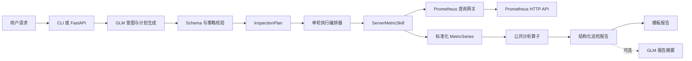

# AI Prometheus 巡检 Agent

基于 GLM-5.3 与受控分析 DSL 的服务器巡检系统。模型只负责理解用户意图并生成受控分析计划；Prometheus 查询、阈值判断、异常识别、统计计算和报告事实全部由 Python 完成。模型不接触 Prometheus API、没有工具调用权限、不编写 PromQL。

## 设计原则

- 大模型负责理解，代码负责判断。
- 先生成 `InspectionPlan`，通过校验后才允许访问 Prometheus。
- 一轮编排：一条请求只生成一次计划，不根据中间结果再次请求模型。
- 按需查询：单指标请求只拉取所需指标，禁止拉取全部指标。
- 所有异常可解释：包含统计值、阈值、时间、严重级别和风险说明。
- 区分实例不存在、指标缺失、查询失败和正常状态。

## 架构



专项 Skill 与公共分析层职责分离：专项 Skill 只做实例发现、标签映射、PromQL 模板和 `MetricSeries` 转换；公共分析层只处理 `MetricSeries`，提供有限、可组合的算子。

## 目录

```text
app/
  api/                    FastAPI 路由与请求模型
  core/                   配置、日志、异常、请求上下文、时间解析
  domain/                 Intent、Plan、MetricSeries、Finding、Report
  nlu/                    GLM 客户端、意图 Schema、规则回退
  planner/                计划构建与校验
  inventory/              静态资产目录与别名解析
  prometheus/             HTTP 客户端、查询模板、安全参数绑定、查询预算
  rules/                  YAML 规则加载与阈值/异常/显著性判定
  skills/
    base.py               专项指标 Skill 协议
    providers/server/     ServerMetricSkill、queries.yaml、metric_catalog.yaml
  analysis/
    operators/            aggregate/filter/sort/limit/group_by/compare/trend/detect_anomaly/summarize
    validator.py          DSL 校验
    executor.py           单轮执行
  reporting/              报告构建与渲染（文本 / Markdown / JSON）
configs/
  assets.yaml             服务器资产与别名
  policies.yaml           异常、对比、趋势与查询预算策略
deploy/k8s/               Kubernetes 清单（Namespace/ConfigMap/Secret/Deployment/Service/Job/CronJob）
tests/                    unit / integration / contract
```

## 安装

```bash
python3 -m venv .venv
source .venv/bin/activate
pip install -r requirements.txt
cp .env.example .env
```

至少配置：

```bash
PROMETHEUS_URL=http://你的Prometheus地址:9090
```

配置 `ZHIPU_API_KEY` 后使用 GLM 解析意图；未配置时使用内置规则回退，巡检功能不受影响。

## 使用

```bash
python3 -m app --check-config
python3 -m app --plan "查看 CPU 使用率最高的机器"
python3 -m app "查询服务器 192.168.59.130 的 CPU"
python3 -m app "巡检服务器 192.168.59.130"
python3 -m app "查询最近 4 天的服务器异常清单"
python3 -m app "对比 192.168.59.130 今天和昨天的运行情况"
python3 -m app "分析服务器 192.168.59.130 最近 7 天 CPU 趋势"
python3 -m app --selftest
```

不传指令进入交互模式。加 `--json` 输出结构化报告。

HTTP API（需安装 `fastapi`、`uvicorn`）：

```bash
uvicorn app.api.app:create_app --factory --host 0.0.0.0 --port 8000
```

- `GET /health`
- `GET /capabilities`
- `POST /inspect`，请求体 `{"instruction": "查询服务器 192.168.59.130 的 CPU"}`

## 任务类型与算子组合

| 任务 | task_type | 算子组合 | 示例 |
| --- | --- | --- | --- |
| 当前巡检 | `instant_inspection` | aggregate → filter → summarize | 查询服务器 192.168.59.130 的 CPU |
| 基础巡检 | `instant_inspection` | aggregate → filter → summarize | 巡检服务器 192.168.59.130 |
| 历史异常 | `historical_anomaly_summary` | detect_anomaly → group_by → sort → summarize | 查询最近 4 天的服务器异常清单 |
| 时段对比 | `period_comparison` | aggregate → compare → filter → summarize | 对比今天和昨天 |
| 趋势分析 | `trend_analysis` | trend → summarize | 分析最近 7 天 CPU 趋势 |
| 排行查询 | `ranking_query` | aggregate → sort → limit → summarize | CPU 使用率最高的机器 |
| 阈值筛选 | `threshold_filter` | aggregate → filter → sort → summarize | 找出 CPU 超过 80% 的机器 |

## 默认指标与阈值

| 逻辑指标 | Prometheus 指标 | 默认规则 |
| --- | --- | --- |
| `availability` | `up` | 小于 1 为严重 |
| `cpu` | `node_cpu_seconds_total` | >85% 告警，>95% 严重 |
| `memory` | `node_memory_MemAvailable_bytes` / `node_memory_MemTotal_bytes` | >90% 告警，>95% 严重 |
| `disk` | `node_filesystem_avail_bytes` / `node_filesystem_size_bytes` | >85% 告警，>95% 严重 |

PromQL 模板在 `app/skills/providers/server/queries.yaml`，指标与阈值在 `metric_catalog.yaml`，异常合并、显著性、趋势和查询预算在 `configs/policies.yaml`。部署环境只需校准配置，无需改动业务代码。

## 扩展新组件

新增 Redis、Kafka 或 MySQL 时复用 `Intent`、`InspectionPlan`、Prometheus 网关、分析 DSL、通用算子、规则引擎、资产目录和报告模型。只需提供：

1. 组件自己的查询模板与指标白名单。
2. 指标的默认阈值、单位和允许使用的通用算子。
3. 实例发现与资产映射规则。
4. 实现 `BaseMetricProvider` 的 Skill 与其测试，并在注册表中登记。

主 Agent、计划校验器、执行编排器和通用分析算子不需要按组件新增业务分支。

## Kubernetes 部署

清单在 `deploy/k8s/`，通过 kustomize 统一编排：

```bash
# 构建并推送镜像，或在集群节点加载本地镜像
docker build -t inspect-agent:v1 .

# 部署前改 secret.yaml 的 ZHIPU_API_KEY、configmap-env.yaml 的 PROMETHEUS_URL、configmap-configs.yaml 的 assets.yaml
kubectl apply -k deploy/k8s
kubectl -n inspect-agent rollout status deploy/inspect-agent-api
```

组成：`Deployment` + `Service`（FastAPI，含 `/health` 探针）、`Job`（一次性巡检）、`CronJob`（默认 `suspend: true`）。`assets.yaml` 与 `policies.yaml` 通过 ConfigMap 只读挂载到 `/app/configs`。

详见 当前工作区 内的 `/deploy/k8s/README.md`。

## 测试

```bash
python3 -m pytest
```

- `tests/unit`：时间解析、资产目录、分析算子、计划校验。
- `tests/integration`：基于模拟 Prometheus 的端到端巡检（只查点名指标、未找到实例、指标缺失、数据源异常、异常清单、时段对比、趋势、排行、阈值筛选、查询预算）。
- `tests/contract`：`MetricSeries` 契约、DSL 校验、查询模板安全绑定。

## 约束

- 所有指标必须来自 Prometheus，禁止编造。
- 禁止查询用户未点名的组件和指标。
- 计划校验不通过时不访问 Prometheus。
- 变更操作只作为建议，需人工确认后执行。
