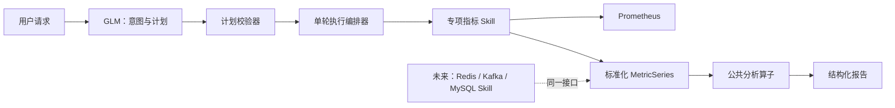
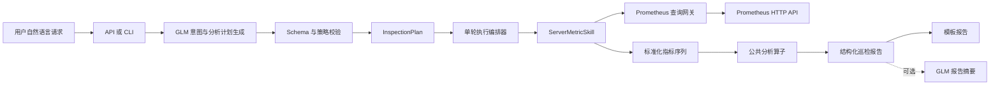

# AI Agent 服务器巡检 Skill 项目计划

## 1. 项目目标

第一阶段交付服务器专项巡检 Skill，并同步建立可复用的公共分析算子框架。专项 Skill 只处理组件特有的资源发现、指标定义和 Prometheus 查询；公共分析算子处理趋势、时间段对比和历史异常汇总等跨组件能力。

本期面向服务器支持以下三类工作：

1. 当前状态巡检，例如“查询服务器 192.168.59.130 的 CPU”。
2. 历史异常汇总，例如“查询最近 4 天的服务器异常清单”。
3. 时段运行对比，例如“对比 192.168.59.130 今天和昨天的运行情况”。

系统使用 GLM-5.3 理解用户意图和生成受控分析计划；Prometheus 数据查询、阈值判断、异常识别、统计计算和报告事实均由 Python 完成。模型不能自行生成 PromQL，不能基于监控数据虚构结论。

Redis、Kafka、Kubernetes 和 MySQL 巡检不在本期实现范围内。它们后续只需新增专项 Skill 及指标映射，即可复用现有公共分析算子，无需重复开发“近 N 天趋势”“时段对比”等任务类型。

## 2. 设计原则

- **大模型负责理解，代码负责判断。** GLM 将自然语言转换为有限的任务类型和参数；所有数据结论来自 Prometheus 与规则引擎。
- **先生成计划，再执行查询。** 每次请求生成不可变的 `InspectionPlan`，通过校验后才允许访问 Prometheus。
- **一轮 Skill 编排。** 每条用户请求只生成一次专项指标采集和公共分析的组合执行计划。计划可以执行预先列出的有限批量查询，但不会根据中间结果再次请求模型决定下一步。
- **按需查询。** 单指标请求只拉取所需指标；历史与对比任务只查询任务定义允许的指标集合，禁止拉取 Prometheus 全部指标。
- **所有异常可解释。** 每条发现必须包含当前或统计值、阈值、采样时间或时间段、严重级别和风险说明。
- **不将未知描述成正常。** 区分实例不存在、指标缺失、查询失败和正常状态。

## 3. Skill 分层架构

Skill 分为两层，职责严格分离：

| 层级 | 名称 | 负责内容 | 不负责内容 |
|---|---|---|---|
| 专项 Skill | `ServerMetricSkill`、未来的 `RedisMetricSkill`、`KafkaMetricSkill`、`MySQLMetricSkill` | 实例发现、组件标签映射、PromQL 模板、原始指标到标准指标的转换 | 趋势判断、跨时段比较、异常事件合并、报告组织 |
| 公共分析层 | `aggregate`、`filter`、`sort`、`compare`、`trend`、`detect_anomaly` 等算子 | 对标准化时间序列做通用计算、规则判断与结构化输出 | 了解 Redis、MySQL 等组件的 PromQL、实例标签或 exporter 差异 |

专项 Skill 输出统一的 `MetricSeries`。公共分析层只处理 `MetricSeries`，因此不关心数据来自服务器、Redis、Kafka 还是 MySQL。

公共层不为每一种用户问法创建一个新 Skill。它提供有限、可组合的分析算子；GLM 将自然语言编译为受控的分析 DSL，计划校验器只允许使用已注册的指标和算子。这样“CPU 使用率最高的机器”“CPU 超过 80% 的机器”“今天比昨天 CPU 增长最多的机器”都是同一套基础能力的不同组合。



一次用户请求仍然只有一次编排执行。专项 Skill 的查询与公共 Skill 的内存分析属于同一个不可变计划：公共 Skill 不重新调用 GLM，也不会基于中间数据触发新的自由查询。

## 4. 总体架构



默认使用模板报告，避免额外模型调用。若配置开启“管理摘要”，才将已经确认的结构化结果交给 GLM 改写为自然语言；该调用只能总结传入事实，不能产生新的监控结论。

## 5. 大模型的调用边界

### 5.1 必需调用：意图和分析计划生成

GLM-5.3 每条请求最多调用一次，用于输出符合 Pydantic Schema 的 JSON。模型输入包括用户请求、支持的任务类型、允许指标、时间范围限制和可用实例解析规则。

模型不接触 Prometheus API，不拥有工具调用权限，不接收 API 密钥，也不直接编写 PromQL。

示例：

用户请求：

```text
对比服务器 192.168.59.130 今天和昨天的运行情况
```

模型输出：

```json
{
  "task_type": "period_comparison",
  "target": {
    "type": "server",
    "instance": "192.168.59.130"
  },
  "metrics": ["cpu", "memory", "disk", "availability"],
  "periods": [
    {"name": "today", "start": "today 00:00", "end": "now"},
    {"name": "yesterday", "start": "yesterday 00:00", "end": "yesterday 23:59:59"}
  ]
}
```

### 5.2 可选调用：报告摘要

报告摘要只能使用结构化巡检结果作为输入。提示词要求模型：

- 只陈述输入中存在的数据和结论。
- 不补充原因、不预测未来、不编造指标。
- 对数据缺失和查询失败明确说明“无法判断”。

该能力默认关闭，开启后每个请求最多增加一次 GLM 调用。

## 6. 服务器专项 Skill 与公共分析算子

### 6.1 专项指标 Skill：组件数据适配器

`ServerMetricSkill` 是服务器领域的唯一专项 Skill。它接收资源目标、逻辑指标和时间范围，执行以下职责：

1. 使用资产目录将 IP、别名或主机名解析为唯一服务器资源。
2. 校验实例是否存在及 Node Exporter 是否有数据。
3. 将逻辑指标如 `cpu`、`memory`、`disk`、`availability` 转成服务器专用 PromQL 模板。
4. 通过 Prometheus 查询网关获取即时值或时间序列。
5. 转换为带单位、标签、采样时间的统一 `MetricSeries`。

它不判断“趋势恶化”、不比较今天和昨天，也不输出面向用户的报告。

未来 `RedisMetricSkill`、`KafkaMetricSkill` 或 `MySQLMetricSkill` 都实现相同协议。例如 Redis 可以把 `used_memory_ratio` 映射为逻辑指标 `memory_usage`；MySQL 可以把连接数映射为 `connections`。公共分析层无需变化。

```python
class MetricProviderSkill(Protocol):
    resource_type: str

    def resolve_target(self, reference: str) -> ResolvedTarget: ...
    def supported_metrics(self) -> list[MetricDefinition]: ...
    def collect(self, request: MetricCollectionRequest) -> list[MetricSeries]: ...
```

`MetricDefinition` 由专项 Skill 声明单位、可支持的聚合方式、查询模板 ID、建议阈值和适用分析任务。例如，磁盘容量可以支持趋势、对比和异常汇总；计数器类指标必须先由专项 Skill 转成速率，才能交给公共层分析。

### 6.2 公共分析层：通用算子，而不是问题 Skill

公共分析层接收已标准化的 `MetricSeries` 和分析 DSL。它不直接访问 Prometheus，不使用组件特定 PromQL，也不按自然语言问题一对一增加 Skill。

第一期实现一组稳定的通用算子：

| 算子 | 输入和功能 | 用户问题示例 |
|---|---|---|
| `aggregate` | 计算均值、最大值、最小值、P95、总和、最新值 | “服务器过去一天 CPU 平均值” |
| `group_by` | 按实例、集群、业务标签或资源类型分组 | “按集群统计 CPU 使用率” |
| `filter` | 用阈值、标签、状态或数据质量过滤 | “找出 CPU 超过 80% 的机器” |
| `sort` | 以数值、变化率、持续时间或事件数排序 | “按 CPU 使用率排序” |
| `limit` | 截取前 N 条或后 N 条结果 | “CPU 最高的 10 台机器” |
| `compare` | 比较两个同口径时间段的绝对与相对变化 | “今天和昨天的运行情况对比” |
| `trend` | 计算斜率、增长率、波动度和持续风险 | “近 15 天 CPU 趋势” |
| `detect_anomaly` | 将越阈值序列合并为异常事件 | “最近 4 天异常清单” |
| `summarize` | 对已确认结果形成统计摘要和报告数据 | “本周最主要的风险” |

公共层可将算子组合为流水线。例如“查看 CPU 使用率最高的 10 台机器”由 `aggregate(avg, group_by=instance)`、`sort(desc)`、`limit(10)` 组成；它不是一个新的“Top N Skill”。

```text
专项 Skill 取 CPU 序列
  → aggregate：按 instance 计算最近 5 分钟平均值
  → sort：按 value 降序
  → limit：保留前 10 台
  → summarize：渲染报告
```

“分析 Redis 最近 15 天内存趋势”和“分析服务器最近 15 天 CPU 趋势”同样复用 `trend`、`aggregate` 和 `summarize`。差异只存在于专项 Skill 如何取数、指标单位和适用规则。

### 6.3 受控分析 DSL 与计划校验

GLM 输出的分析动作必须是算子白名单中的结构化声明，不能输出任意 Python、SQL 或 PromQL：

```json
{
  "resource_type": "server",
  "target_scope": "all_authorized_instances",
  "metrics": ["cpu"],
  "time_range": {"type": "relative", "value": "5m"},
  "operations": [
    {"type": "aggregate", "function": "avg", "group_by": ["instance"]},
    {"type": "sort", "field": "value", "direction": "desc"},
    {"type": "limit", "count": 10},
    {"type": "summarize"}
  ]
}
```

计划校验器必须验证：

1. `resource_type` 已注册对应专项 Skill。
2. 目标指标由该专项 Skill 声明支持。
3. 每个算子已注册，且该指标允许该算子，例如计数器先由专项 Skill 转换为速率才允许做趋势分析。
4. 算子顺序有效，例如 `limit` 必须在 `sort` 后，`compare` 需要两个合法时间段。
5. 作用域、时间范围、Top N、分组维度和预计查询量符合策略限制。

没有可执行计划时，系统返回“当前未配置该分析能力”，并说明已支持的相近指标或算子；不会让模型临时生成查询逻辑。

### 6.4 标准化指标契约

```python
class MetricSeries(BaseModel):
    resource_id: str
    resource_type: str              # server / redis / kafka / mysql
    metric_id: str                  # cpu_usage_percent / redis_memory_usage_percent
    display_name: str
    unit: Literal["percent", "bytes", "count", "seconds", "ratio"]
    timestamps: list[datetime]
    values: list[float | None]
    dimensions: dict[str, str]
    collection_status: Literal["ok", "missing", "partial", "error"]
    source_time_range: TimeRange
```

公共 Skill 只对 `collection_status="ok"` 或可安全处理的 `partial` 数据分析。`missing` 和 `error` 必须原样进入报告，不能被转成健康结论。

## 7. 服务器专项 Skill 支持的指标与公共分析组合

| 分析任务 | 算子组合 | 自然语言示例 | 查询范围 | 输出 |
|---|---|---|---|
| 当前巡检 | `aggregate → filter → summarize` | 查询服务器 192.168.59.130 的 CPU | 一个实例，用户指定指标 | 当前值、阈值、异常项 |
| 基础巡检 | `aggregate → filter → summarize` | 巡检服务器 192.168.59.130 | 一个实例，基础指标集 | 当前健康状态与异常项 |
| 历史异常 | `detect_anomaly → group_by → sort → summarize` | 查询最近 4 天的服务器异常清单 | 授权范围内服务器，指定时间段 | 异常事件、持续时间、峰值、恢复状态 |
| 时段对比 | `aggregate → compare → filter → summarize` | 对比某服务器今天和昨天的运行情况 | 一个实例，两个时间段 | 均值、最大值、P95、变化比例、异常时长 |
| 趋势分析 | `trend → aggregate → filter → summarize` | 分析服务器最近 7 天 CPU 趋势 | 一个实例，一个时间段 | 趋势方向、斜率、峰值、持续风险 |
| 排行查询 | `aggregate → sort → limit → summarize` | 查看 CPU 使用率最高的机器 | 授权范围内服务器 | 前 N 台实例及数值、阈值和风险 |
| 阈值筛选 | `aggregate → filter → sort → summarize` | 找出 CPU 超过 80% 的机器 | 授权范围内服务器 | 命中实例及当前或统计值 |

第一阶段默认指标：

| 逻辑指标 | 示例 Prometheus 指标 | 默认规则 |
|---|---|---|
| `availability` | `up` | 值小于 1 为严重异常 |
| `cpu` | `node_cpu_seconds_total` | 5 分钟 CPU 使用率大于 85% 为告警，大于 95% 为严重 |
| `memory` | `node_memory_MemAvailable_bytes`、`node_memory_MemTotal_bytes` | 使用率大于 90% 为告警，大于 95% 为严重 |
| `disk` | `node_filesystem_avail_bytes`、`node_filesystem_size_bytes` | 使用率大于 85% 为告警，大于 95% 为严重 |

实际 PromQL、`job` 标签、排除的文件系统类型和阈值必须放在配置文件中，由部署环境校准，不能散落在业务代码中。

## 8. 核心数据模型

### 8.1 Intent

模型输出经校验后的意图。

```python
class InspectionIntent(BaseModel):
    task_type: Literal[
        "instant_inspection",
        "historical_anomaly_summary",
        "period_comparison",
        "trend_analysis",
    ]
    target_type: Literal["server"]
    instance: str | None
    metrics: list[Literal["cpu", "memory", "disk", "availability"]]
    time_range: TimeRange | None
    periods: list[NamedTimeRange] = []
```

### 8.2 InspectionPlan

策略层生成的不可变执行计划。它是 Skill 唯一允许执行的指令来源。

```python
class InspectionPlan(BaseModel):
    request_id: str
    task_type: str
    target: ServerTarget
    provider_skill: str
    operations: list[AnalysisOperation]
    queries: list[MetricQueryPlan]
    max_query_count: int
    timeout_seconds: int
    report_mode: Literal["template", "llm_summary"]
```

`MetricQueryPlan` 只包含来自受信任配置的查询模板 ID、实例参数、时间范围和聚合方式，不接受模型输出的原始 PromQL。

### 8.3 Finding 与 Report

```python
class Finding(BaseModel):
    instance: str
    metric: str
    severity: Literal["warning", "critical"]
    value: float | None
    unit: str
    threshold: str
    observed_at: datetime | None
    started_at: datetime | None
    ended_at: datetime | None
    risk: str
    status: Literal["active", "recovered", "unknown"]
```

报告还必须携带 `query_status`，其取值至少包含：`healthy`、`not_found`、`metric_missing`、`data_source_error`、`partial_data`。

## 9. 执行流程

### 9.1 当前巡检

1. 解析用户意图。
2. 校验实例格式、指标白名单和请求权限。
3. 从资产目录解析实例别名或确认目标存在。
4. 生成仅含请求指标的计划。
5. `ServerMetricSkill` 先通过 `up` 或资产标签进行实例发现。
6. 找不到实例时返回“未找到对应实例”，停止后续查询。
7. `ServerMetricSkill` 查询目标指标并转换为 `MetricSeries`，公共分析层执行计划指定的 `aggregate`、`filter` 和 `summarize` 算子。
8. 仅输出异常项；无异常时输出简短健康结论。

### 9.2 最近 N 天异常清单

1. 将“最近 N 天”解析为固定起止时间，并限制最大范围，例如 30 天。
2. 计划选择 CPU、内存、磁盘、可用性四组固定查询模板，由 `ServerMetricSkill` 提取标准序列。
3. 公共分析层对标准序列执行 `detect_anomaly`，使用固定采样步长。
4. 将连续越阈值的样本合并为一个异常事件。
5. 计算峰值、平均值、P95、开始时间、结束时间、持续时长和是否恢复。
6. 按严重级别、持续时间和最近发生时间排序，输出异常清单。

### 9.3 两个时段运行对比

1. 解析两个时间段，要求时间段不重叠并且长度可比较。
2. `ServerMetricSkill` 为每个时段提取相同的标准指标序列。
3. 公共分析层执行 `aggregate` 和 `compare`，计算平均值、最大值、P95、异常时长和不可用时长。
4. 公共 Skill 计算绝对变化与相对变化。
5. 规则引擎按显著变化阈值输出“改善、稳定、恶化、无法判断”。
6. 报告仅列出显著变化和异常，稳定项以简短摘要表达。

## 10. 异常事件与比较规则

异常事件不能简单按单个采样点输出。建议规则：

- CPU、内存和磁盘连续两个采样点越阈值，才认定为异常事件。
- 采样点间隔不超过两倍计划步长时，归为同一个事件。
- 连续恢复两个采样点后，事件结束。
- 数据缺口超过允许范围时，事件状态为 `unknown`，不认定为自动恢复。
- 变化显著性同时满足绝对变化和相对变化，例如 CPU 平均值增加至少 10 个百分点且相对增加至少 20%。
- 可用性按不可用时间累计；不可将采集缺失等同于服务不可用。

阈值、持续时间、采样步长和显著变化标准都应通过版本化 YAML 配置管理。

## 11. 资产目录与实例发现

第一阶段采用静态 YAML 资产目录，支持别名映射：

```yaml
servers:
  - id: server-prod-130
    aliases: ["192.168.59.130", "app-server-01"]
    prometheus_instance: "192.168.59.130:9100"
    environment: prod
    prometheus_job: node-exporter
```

流程如下：

1. 用户输入实例名称、IP 或别名。
2. 资产目录解析为唯一资源 ID 和真实 Prometheus 标签。
3. 未命中资产目录时，返回“未找到对应实例”。
4. 命中资产但 Prometheus 未返回存在性指标时，返回“实例存在，但监控数据不可用”。

这样可以避免把用户输入直接拼进 PromQL，也能区分资产不存在与监控缺失。

## 12. 项目目录建议

```text
inspect-agent/
  app/
    api/                    # FastAPI 路由、鉴权、请求模型
    core/                   # 配置、日志、异常、依赖注入
    domain/                 # Intent、Plan、Finding、Report
    nlu/                    # GLM 客户端、JSON Schema、意图规范化
    planner/                # 策略校验、计划构建、查询预算
    inventory/              # 静态资产目录与别名解析
    prometheus/             # HTTP 客户端、查询模板、安全参数绑定
    rules/                  # YAML 规则加载、阈值和时间序列判定
    skills/
      base.py               # 专项指标 Skill 协议
      providers/            # 专项指标 Skill
        server/
          skill.py          # ServerMetricSkill
          queries.yaml      # Server PromQL 模板
          metric_catalog.yaml
    analysis/               # 通用分析算子与 DSL 执行器
      operators/
        aggregate.py
        filter.py
        sort.py
        limit.py
        compare.py
        trend.py
        detect_anomaly.py
        summarize.py
      validator.py
      executor.py
    reporting/              # JSON、Markdown、中文文本渲染
  configs/
    assets.yaml
    policies.yaml
  tests/
    unit/
    integration/
    contract/
  README.md
  pyproject.toml
```

## 13. 分阶段交付计划

### 阶段 A：架构骨架和契约

- 定义 Pydantic 数据模型、错误码和请求链路 ID。
- 建立 GLM 受限 JSON 输出和校验机制。
- 建立 `InspectionPlan` 与策略校验器。
- 创建 Prometheus 查询网关、专项指标 Skill 协议、分析 DSL、公共算子协议及结构化日志。

验收：未知任务、未知指标、非法实例、超出时间范围的请求均不会访问 Prometheus。

### 阶段 B：Server 即时巡检

- 实现资产目录和实例发现。
- 实现 CPU、内存、磁盘、可用性四类数据采集与 `aggregate`、`filter`、`summarize` 当前值分析。
- 完成“未找到实例”“指标缺失”“Prometheus 错误”的区分。
- 实现模板化中文巡检报告。

验收：查询 CPU 时只发起发现和 CPU 所需查询，不查询内存与磁盘。

### 阶段 C：历史异常清单

- 实现时间范围解析、`query_range`、`detect_anomaly` 异常事件合并。
- 实现峰值、持续时间、恢复状态和严重度排序。
- 支持“最近 N 天服务器异常清单”。

验收：报告可说明异常发生时间、持续时长、峰值与当前状态；采集缺失不被报告为正常或已恢复。

### 阶段 D：时段对比与趋势

- 实现 `compare` 两个时段的等口径聚合比较，以及 `trend` 趋势分析。
- 实现绝对和相对变化判定。
- 实现趋势斜率、峰值和持续高负载识别。

验收：今天与昨天的数据分别统计，报告只列出显著变化和异常。

### 阶段 E：服务化和交付

- 提供 FastAPI、CLI、Docker Compose 和示例配置。
- 加入健康检查、审计日志、请求超时、并发和查询预算限制。
- 提供单元测试、Prometheus 模拟集成测试和示例调用文档。

## 14. 关键验收用例

| 用例 | 预期结果 |
|---|---|
| 查询服务器 `192.168.59.130` 的 CPU | 只执行实例发现与 CPU 查询，不执行内存、磁盘查询 |
| 巡检未知服务器 | 输出“未找到对应实例”，不执行指标查询 |
| 查询最近 4 天服务器异常清单 | 返回越阈值事件、时间、峰值、持续时长与恢复状态 |
| 对比今日和昨日 | 返回同口径统计及明显改善、稳定或恶化结论 |
| Prometheus 超时 | 返回数据源异常，不输出健康结论 |
| 指标无数据 | 返回指标缺失或无法判断，不将其视作正常 |
| GLM 返回非法任务 | 请求在计划校验阶段失败，不访问 Prometheus |
| 结果全部正常 | 一句话描述实例或范围健康，不罗列全部正常指标 |
| CPU 使用率最高的机器 | 在合法作用域内执行 `aggregate → sort → limit`，不需要新增问题 Skill |
| 新增 MySQL 专项 Skill | 仅实现 MySQL 的资源发现、PromQL 与指标映射，可直接使用已有通用分析算子 |

## 15. 后续扩展原则

后续新增 Redis、Kafka、Kubernetes 或 MySQL 时，复用 `Intent`、`InspectionPlan`、Prometheus 网关、分析 DSL、通用分析算子、规则引擎、资产目录和报告模型。新增组件只需提供：

- 组件自己的查询模板和指标白名单。
- 指标的默认阈值、单位和允许使用的通用分析算子。
- 实例发现和资产映射规则。
- 对应的 Skill 实现与测试。

主 Agent、计划校验器、执行编排器和通用分析算子不应因新增组件修改业务分支。

