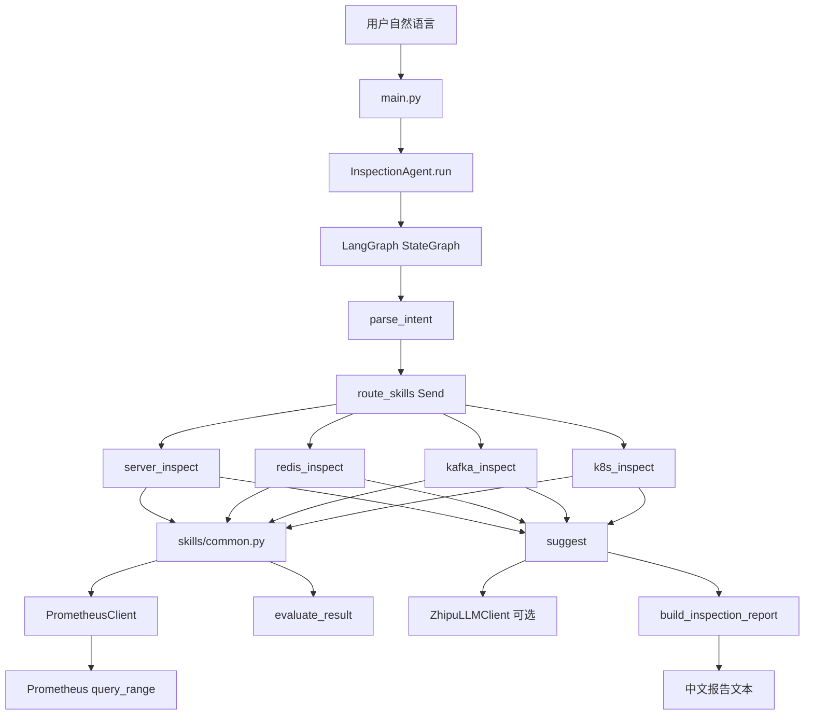
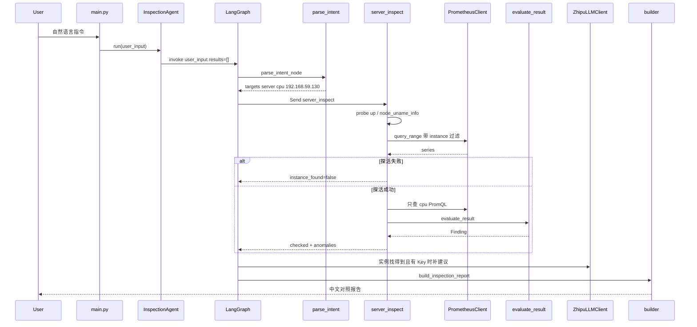

# Prometheus 巡检 Agent 开发手册

面向开发人员与 SRE 的协作文档。依据仓库当前代码整理，覆盖架构、接口、数据流与扩展方式。

分层约定：

- **框架底座**：入口、配置、LangGraph 编排、Agent 门面、报告渲染
- **公共工具**：Prometheus 客户端、意图解析、阈值评估、实例过滤、Skill 公共函数
- **可插拔 Skill 插件**：主机 / Redis / Kafka / Kubernetes 四类巡检能力

---

# 1. 项目总览

## 1.1 业务目标

本项目是一个命令行巡检 Agent。运维用自然语言下达指令，例如「查询服务器 192.168.59.130 的 cpu」「巡检 redis6404」「做一个全面巡检」。Agent 从 Prometheus 取数、在代码里对照阈值，输出一份带数值对照的中文报告。

业务边界：

- 只做查询与分析，不改服务器、不改集群、不做消息推送
- 变更建议必须标注「需要人工确认后执行」
- 指标必须来自 Prometheus；查询失败输出真实错误，禁止编造数值
- 无 Web 服务；配置来自 `.env` / ConfigMap / Secret

目标用户：SRE、平台开发。协作方式：每人维护自己的 Skill 文件，图编排自动发现注册表。

## 1.2 技术栈

**语言与运行时**

- Python >= 3.10（镜像为 python:3.11-slim）

**编排与 SDK**

- LangGraph >= 0.2.45：StateGraph + `Send` 并行分发 Skill
- zai-sdk==0.2.3：`from zai import ZhipuAiClient`（国内平台）或 `ZaiClient`；禁止与旧包 `zhipuai` 并存
- requests：Prometheus HTTP
- python-dotenv：本地 `.env`

**外部系统**

- Prometheus `/api/v1/query_range`
- 智谱 GLM-5.3 对话接口（可选；只补一两句建议，不再调工具）
- 依赖的 exporter：node_exporter、redis_exporter、kafka_exporter/JMX、kube-state-metrics / cAdvisor

**交付形态**

- CLI：`python main.py [指令]`
- Docker 镜像 `inspect-agent:v1`
- Kubernetes：Deployment（`sleep infinity` 后 `kubectl exec`）、Job（跑一次）、CronJob（默认 `suspend: true`）

## 1.3 核心设计原则

1. **意图先行，Skill 后行**。自然语言先解析成对象类型、实例、指标，再决定调哪个 Skill。LLM 不负责选 PromQL。
2. **Skill 内封装查询与判断**。PromQL、探活、阈值比较都在 Python 里完成。
3. **单轮、按需**。一次请求最多一轮 Skill。未说全集群只调匹配 Skill。点名 CPU 只查 CPU。
4. **实例先探活**。指定实例在 Prometheus 里找不到，立即返回「未找到对应实例」，后续业务指标不再查。
5. **实例归属校验**。指定主机的 PromQL 带精确 matcher；结果序列必须属于该实例。查 `192.168.59.131` 不得输出 `192.168.59.130` 的数。
6. **可插拔**。扩展点是 `agent/skills/` + `build_default_skills()`。注册后图自动加成节点。
7. **只读安全**。Agent 不做变更；报告结尾固定声明需要人工确认。

## 1.4 目录结构

```text
.
├── main.py                      CLI 入口
├── requirements.txt             zai-sdk / langgraph / requests / dotenv
├── Dockerfile                   python:3.11-slim，USER 10001
├── .env.example                 配置模板
├── agent/                       业务代码
│   ├── agent.py                 InspectionAgent 门面
│   ├── graph.py                 LangGraph 状态与节点
│   ├── intent.py                自然语言 -> InspectionIntent
│   ├── config.py                Settings / Thresholds
│   ├── prometheus_client.py     Prometheus HTTP
│   ├── utils.py                 时间范围、实例、PromQL 过滤
│   ├── planner.py               --plan 离线规划
│   ├── doctor.py                --doctor 环境诊断
│   ├── config_check.py          --check-config
│   ├── logger.py
│   ├── skills/                  可插拔 Skill
│   │   ├── base.py              Skill / SkillRegistry
│   │   ├── __init__.py          build_default_skills()
│   │   ├── common.py            探活、查询、payload
│   │   ├── catalogs.py          Redis/Kafka/K8s 指标目录；SERVER_METRICS 别名
│   │   ├── server_inspect.py
│   │   ├── redis_inspect.py
│   │   ├── kafka_inspect.py
│   │   └── k8s_inspect.py
│   ├── inspection/              评估与主机指标定义
│   │   ├── host_metrics.py      主机指标真正目录
│   │   ├── evaluator.py         Finding 阈值判断
│   │   └── models.py            Finding 等数据类
│   ├── report/builder.py        报告文本
│   └── llm/                     智谱客户端
├── tests/selftest.py            离线自测 18 项
└── deploy/k8s/                  Namespace / ConfigMap / Secret / Job / CronJob / Deployment
```

## 1.5 整体架构

一次请求走固定四段图：

```text
用户指令
  -> parse_intent（对象 / 实例 / 指标）
  -> Send 到匹配 Skill 节点（全集群并行）
  -> Skill：探活 -> PromQL -> 阈值 -> checked + anomalies
  -> suggest（可选 LLM 一两句）-> report（中文对照报告）
```

三层职责：

| 层 | 职责 | 不做什么 |
| --- | --- | --- |
| 框架底座 | 解析意图、路由、汇总报告、可选 LLM 建议 | 不写 PromQL、不算阈值 |
| 公共工具 | HTTP 查询、实例过滤、阈值评估、标准 payload | 不感知具体组件业务语义 |
| Skill 插件 | 探活表达式、指标目录、default_metrics | 不直接调 LLM、不渲染最终报告 |



---

# 2. 模块划分与模块职责

## 2.1 框架底座

| 文件 | 作用 |
| --- | --- |
| `main.py` | argparse：`--selftest` / `--check-config` / `--plan` / `--doctor` / 单次指令 / 交互循环。真正巡检时构造 `InspectionAgent` 并 `run()`。 |
| `agent/agent.py` | 门面。编译图、`invoke({"user_input", "results": []})`、按名执行 Skill、按需调 LLM。 |
| `agent/graph.py` | `InspectionState`、节点函数、`Send` 路由、按意图顺序重排 results。 |
| `agent/config.py` | `Settings` / `Thresholds`，全部从环境变量读取。 |
| `agent/report/builder.py` | 把 intent + Skill payload 拼成对照报告。 |
| `agent/report/formatter.py` | `render_report` / `format_fallback_report`，给失败兜底。 |
| `agent/logger.py` | 标准输出日志，logger 名 `inspect-agent`。 |
| `agent/planner.py` | `--plan`：只打印将调用的 Skill 和指标。 |
| `agent/doctor.py` | `--doctor`：解释器、依赖导入、zai 客户端类。 |
| `agent/config_check.py` | 占位 Key、超时、警告阈值大于严重阈值等静态检查。 |

## 2.2 公共工具

| 文件 | 作用 |
| --- | --- |
| `agent/intent.py` | 关键字意图解析。全集群、组件、实例、点名指标。 |
| `agent/prometheus_client.py` | `query_range`，矩阵摘要为 latest/max/min/avg，最多 20 条。 |
| `agent/utils.py` | 时间范围、IP/主机提取、`prometheus_instance_matcher`、`apply_instance_filter`、`bind_prometheus_result_to_instance`。 |
| `agent/inspection/evaluator.py` | `evaluate_result`：PromQL 结果 -> `Finding`，`gte` / `lte` 两档阈值。 |
| `agent/inspection/models.py` | `Finding` / `QueryRecord` / `InspectionContext`。当前主路径用 `Finding`。 |
| `agent/inspection/host_metrics.py` | 主机 7 项指标真正定义。 |
| `agent/skills/common.py` | Skill 共用：schema、探活、查询、payload、指标规范化。 |
| `agent/skills/catalogs.py` | `SERVER_METRICS = HOST_METRICS`；Redis / Kafka / K8s 目录；`catalog_for()`。 |
| `agent/skills/base.py` | 抽象 `Skill` 与 `SkillRegistry`。 |
| `agent/llm/sdk.py` | 只导入 `zai.ZhipuAiClient` / `ZaiClient`。 |
| `agent/llm/client.py` | 对话调用、超时判定、`LLMTimeoutError`。 |

## 2.3 可插拔 Skill 插件

| Skill | 文件 | target_type | 探活 PromQL | 默认指标 |
| --- | --- | --- | --- | --- |
| `server_inspect` | `server_inspect.py` | server | `up`, `node_uname_info` | cpu / memory / disk / disk_io / load / network_rx / network_tx |
| `redis_inspect` | `redis_inspect.py` | redis | `redis_up`, `redis_connected_clients`, `redis_memory_used_bytes` | up / memory / clients / blocked / rejected / ops |
| `kafka_inspect` | `kafka_inspect.py` | kafka | `kafka_brokers`, `up`, `kafka_server_brokertopicmetrics_messagesin_total` | brokers / under_replicated / offline / lag |
| `k8s_inspect` | `k8s_inspect.py` | k8s | `kube_pod_info`, `kube_node_info`, `kube_pod_status_phase` | restarts / cpu / memory / not_ready |

四个 `execute()` 结构相同，差异只在 catalog、探活列表、`name` / `target_type`。

## 2.4 兼容遗留层

这些文件不再承担主路径，指向新实现或主动报错：

- `agent/inspection/registry.py`：调用即 `RuntimeError`，提示改用 `build_default_skills`
- `agent/inspection/host.py`：`HostInspectionCapability = ServerInspectSkill`
- `agent/inspection/extensions.py`：Redis/Kafka/K8s 旧名别名
- `agent/inspection/base.py`：旧 Capability 抽象，当前图不调用
- `agent/skills/prometheus.py`：`PrometheusQuerySkill = PrometheusClient`，LLM 查询工具已下线

## 2.5 模块依赖

```mermaid
flowchart LR
    main.py --> agent.py
    agent.py --> graph.py
    agent.py --> skills_init[skills/__init__.py]
    agent.py --> llm_client[llm/client.py]
    graph.py --> intent.py
    graph.py --> builder[report/builder.py]
    skills_init --> server_inspect.py
    skills_init --> redis_inspect.py
    skills_init --> kafka_inspect.py
    skills_init --> k8s_inspect.py
    server_inspect.py --> common.py
    redis_inspect.py --> common.py
    kafka_inspect.py --> common.py
    k8s_inspect.py --> common.py
    common.py --> prometheus_client.py
    common.py --> evaluator.py
    common.py --> utils.py
    catalogs.py --> host_metrics.py
    intent.py --> catalogs.py
    intent.py --> utils.py
```

依赖方向：插件依赖公共工具；公共工具不依赖具体 Skill 类。图只依赖注册表接口。

---

# 3. 核心类与核心函数文档

## 3.1 框架底座

### `InspectionAgent`（`agent/agent.py`）

巡检门面。测试可注入 `skill_registry` 和 `llm_client`。

| 方法 | 入参 | 返回 |
| --- | --- | --- |
| `__init__(settings, skill_registry=None, llm_client=None)` | `Settings`；注册表默认 `build_default_skills`；LLM 可空 | 实例 |
| `graph()` | 无 | 编译后的 LangGraph，懒加载复用 |
| `run(user_input)` | 自然语言 | 报告字符串；空输入返回提示语 |
| `_run_one(name, arguments)` | Skill 名；`instance` / `metrics` / `time_range` | Skill payload；异常时 `ok=false` 的失败字典 |
| `_need_llm()` | 无 | 注入了 LLM 或配置了 `ZHIPU_API_KEY` 则为 True |
| `_ask_llm(instruction, intent, results)` | 指令、意图、Skill 结果 | 建议文本；超时返回说明；其它失败返回空串 |

`run()` 必须 `invoke({"user_input": ..., "results": []})`。`results` 带 reducer，初始必须是列表。

### `build_inspection_graph(agent)`（`agent/graph.py`）

入参：已构造的 `InspectionAgent`。返回编译后的图。

节点：

- `parse_intent`：`state.user_input` -> `intent` 字典
- 每个已注册 Skill：`Send` 载荷 -> `_run_one` -> `{results: [payload]}`
- `suggest`：实例全部缺失则跳过 LLM
- `report`：按 `intent.targets` 顺序排序后渲染

条件边：`parse_intent` -> `route_skills`。无可用 Skill 时字符串 `"suggest"`。

### `InspectionState`

| 字段 | 类型 | 说明 |
| --- | --- | --- |
| `user_input` | str | 原始指令 |
| `intent` | dict | `intent_to_dict` 产物 |
| `results` | list | `Annotated[..., _append_results]`，多 Skill 追加 |
| `extra_suggestions` | str | LLM 建议 |
| `report` | str | 最终文本 |

### `Settings` / `Thresholds` / `load_settings`

`load_settings(dotenv_path=None)` 读环境变量，返回冻结 `Settings`。阈值字段与 `.env.example` 一一对应。数字解析失败抛 `ValueError`。

### `build_inspection_report(intent, results, extra_suggestions="")`

入参：`InspectionIntent`、Skill payload 列表、建议字符串。返回报告文本。找不到实例时写「未找到对应实例」。已找到的对象列出每条 `checked` 的当前/最新/均值/峰值与两档阈值。

## 3.2 意图

### `InspectionIntent`

| 字段 | 含义 |
| --- | --- |
| `user_input` | 原句 |
| `time_range` | 规范化范围，如 `2h` |
| `cluster_wide` | 是否四个 Skill 全跑 |
| `targets` | `{target_type, skill, instance, metrics}` 列表 |
| `skill_names` | 去重后的 Skill 名 |

### `parse_intent(instruction, default_time_range="2h")`

返回 `InspectionIntent`。

规则摘要：

- 全集群关键词见 `_FULL_CLUSTER_HINTS`（含「全面巡检」「全集群巡检」「完整巡检」等）
- 组件关键词：redis / kafka / k8s|kubernetes|kube|pod|容器 / 服务器|主机|server|host
- `metrics=[]` 表示该组件基础健康集；点名则只含对应 key
- 解析不到任何组件时 `target_types = ["server"]`

## 3.3 Skill 抽象与注册

### `Skill`（抽象）

| 成员 | 说明 |
| --- | --- |
| `name` / `description` / `target_type` | 类属性 |
| `__init__(settings, prometheus=None)` | 默认自建 `PrometheusClient` |
| `parameters_schema()` | JSON Schema |
| `execute(**kwargs)` | 入参 `instance` / `metrics` / `time_range`，返回 payload |
| `default_metrics()` | 未点名时的 key 列表 |
| `to_tool_spec()` | Function Calling 形态，当前主路径不把 tools 传给 LLM |

### `SkillRegistry`

`register(skill)` / `get(name)` / `by_target(target_type)` / `all_skills()` / `names()` / `tool_specs(names=None)`。`get` 找不到抛 `KeyError`。

### `build_default_skills(settings, prometheus=None)`

共享同一个 `PrometheusClient`，按 Server / Redis / Kafka / K8s 顺序 register，返回注册表。

## 3.4 公共查询与评估

### `PrometheusClient.query_range(promql, time_range)`

成功：`ok, promql, time_range, start, end, step, result_type, series_count, series`。失败：`ok=false, error, promql, time_range`。空 PromQL、时间解析失败、缺 requests、超时、非 200、非 JSON、`status!=success` 都走失败分支。

### `probe_instance(prometheus, probes, instance, time_range)`

`instance` 为空视为全集群/未指定，直接 `found=True`。否则依次跑探活 PromQL，任一有可用序列即成功。

### `run_metric_queries(prometheus, catalog, metric_keys, instance, time_range, thresholds)`

返回 `(checked, anomalies)`。只查 catalog 中 key 落在 `metric_keys` 的项。`severity in {warning, critical, error}` 进入 anomalies。

### `skill_payload(...)`

标准返回，字段见第 5 章。`instance_found=False` 时强制 `message="未找到对应实例"`，`checked`/`anomalies` 为空。

### `normalize_metrics(raw, catalog, fallback=None)`

字符串按逗号拆；列表逐项对 catalog key。对得上返回去重列表，否则 `fallback or catalog 全部 key`。

### `evaluate_result(metric_def, result, thresholds, purpose="primary")`

返回 `list[Finding]`。查询失败 -> `severity=error`。无可用序列 -> `unknown`。`compare=lte` 用于 redis_up、kafka_brokers 这类「越低越差」。峰值优先用 `max`，否则 `latest`。

### `Finding`

`metric_key, metric_name, meaning, unit, labels, latest, max_value, avg_value, warning, critical, severity, source_promql, error, purpose`。

### 实例工具（`agent/utils.py`）

| 函数 | 作用 |
| --- | --- |
| `parse_time_range(raw, default)` | `(规范化字符串, 秒)` |
| `parse_instance(raw)` | 提取 IP 或「主机/服务器/instance=」后的标识 |
| `prometheus_instance_matcher(instance)` | 带端口用 `=`，否则 `=~"host(:[0-9]+)?"`，点号写成 `[.]` |
| `apply_instance_filter(promql, instance)` | 给指标选择器加/替换 instance 过滤 |
| `series_matches_instance(metric, instance)` | 标签 instance 主机部分相等即可（端口可不同） |
| `bind_prometheus_result_to_instance(result, instance)` | 无匹配则失败，错误含实际返回的 instance |

### `ZhipuLLMClient.chat(messages, tools=None, temperature=0.2, max_tokens=4096, round_index=1)`

调用 `client.chat.completions.create`。当前 `suggest` 传 `tools=None`。超时包装为 `LLMTimeoutError`。

## 3.5 四个 Skill.execute

统一签名：`execute(instance="", metrics=[], time_range="") -> dict`。

流程：规范化 metrics -> `probe_instance` -> 失败返回未找到 -> `run_metric_queries` -> `skill_payload(instance_found=True, checked, anomalies)`。

---

# 4. 业务时序文档

## 4.1 启动

```text
main.py
  -> load_settings()
  -> setup_logger()
  -> ZhipuLLMClient(settings) 仅当 ZHIPU_API_KEY 非空
  -> InspectionAgent(settings, llm_client=...)
  -> 首次 run() 时 build_inspection_graph：按 registry 为每个 Skill add_node
```

## 4.2 一次巡检端到端

以「查询服务器 192.168.59.130 的 cpu」为例。



步骤：

1. **意图**。`cluster_wide=false`，一个 target：`server_inspect`，instance=`192.168.59.130`，metrics=`["cpu"]`。
2. **路由**。`route_skills` 只 `Send("server_inspect", {instance, metrics, time_range})`。
3. **探活**。`up` / `node_uname_info` 加上 `instance=~"192[.]168[.]59[.]130(:[0-9]+)?"`。无序列则停。
4. **按需查询**。只跑 HOST_METRICS 里 key=cpu 的那条。磁盘内存等全部跳过。
5. **评估**。峰值对照 80/90，写入 checked；超阈值同时进 anomalies。
6. **建议**。全部 `instance_found=false` 时不调 LLM。
7. **报告**。列出当前/最新/均值/峰值与阈值；异常附加 risk。

## 4.3 全集群 / 全面巡检

「做一个全面巡检」命中 `_FULL_CLUSTER_HINTS`，`cluster_wide=true`，四个 target、`instance=None`、`metrics=[]`。

`Send` 四个节点并行。未指定 instance 时探活直接 `found=True`，各 Skill 跑自己的 default_metrics。`results` 由 reducer 拼接，报告前按 targets 顺序排序。

## 4.4 实例不存在

「帮我查看 192.168.59.131 这台服务器」：探活过滤后无序列，`bind_*` 失败信息写入 `error`，payload `instance_found=false`，报告「未找到对应实例：服务器主机 / 192.168.59.131」。禁止回退到未过滤 PromQL。

## 4.5 Skill 注册 / 发现 / 调用（框架视角）

```text
build_default_skills
  -> registry.register(各 Skill 实例)
InspectionAgent.graph()
  -> for skill in all_skills(): add_node(skill.name)
parse_intent.targets[].skill
  -> route_skills 校验 name in registry.names()
  -> Send(name, arguments)
skill_node
  -> agent._run_one(name, arguments)
  -> registry.get(name).execute(**arguments)
```

图编译期发现插件；运行期只按意图里的名字调用。新增 Skill 只要 register，不必改 `graph.py` 节点列表。意图侧仍需加关键词，否则默认仍走 server。

---

# 5. 核心数据结构文档

## 5.1 指标元数据（catalog item）

主机目录在 `agent/inspection/host_metrics.py`；Redis/Kafka/K8s 在 `agent/skills/catalogs.py`。`SERVER_METRICS` 是 `HOST_METRICS` 的别名。

| 字段 | 类型 | 必填 | 说明 |
| --- | --- | --- | --- |
| `key` | str | 是 | 意图与 metrics 入参使用的短名，如 `cpu` |
| `name` | str | 是 | 报告中文名，如 `CPU使用率` |
| `meaning` | str | 建议 | 指标含义 |
| `promql` | str | 是 | 未带 instance 过滤的模板 |
| `unit` | str | 是 | `%` / `Mbps` / `ops/s` / 空 |
| `warning_attr` | str | 阈值项必填 | `Thresholds` 属性名 |
| `critical_attr` | str | 阈值项必填 | 同上 |
| `compare` | str | 否 | 默认 `gte`（越高越差）；`lte` 越低越差 |
| `business_impact` | str | 建议 | 写入 payload.risk，异常行展示 |
| `check_commands` | list[str] | 主机有 | 给人口令，当前报告未渲染 |
| `optimize_suggestions` | list[str] | 主机有 | 当前报告未渲染 |
| `followups` | list | 主机有 | 下钻 PromQL；当前 `run_metric_queries` 不自动查 |

`catalog_for(target_type)` 返回对应列表。意图 `_pick_metrics` 用它校验 key。

现网 key 一览：

- server：`cpu` `memory` `disk` `disk_io` `load` `network_rx` `network_tx`
- redis：`up` `memory` `clients` `blocked` `rejected` `ops`
- kafka：`brokers` `under_replicated` `offline` `lag`
- k8s：`restarts` `cpu` `memory` `not_ready`

同名 `cpu`/`memory` 分属不同 catalog，互不串目录。

## 5.2 Skill 工具入参 schema

`inspect_schema(target, metric_hint)`：

```json
{
  "type": "object",
  "properties": {
    "instance": {
      "type": "string",
      "description": "<组件> 实例标识，例如主机 IP、redis6404、Pod 名。全集群巡检可为空。"
    },
    "metrics": {
      "type": "array",
      "items": {"type": "string"},
      "description": "需要查询的指标 key 列表。<hint> 为空则做该组件基础健康巡检。"
    },
    "time_range": {
      "type": "string",
      "description": "查询时间范围，例如 30m、1h、2h"
    }
  },
  "required": []
}
```

LangGraph `Send` 载荷与此三字段对齐。`instance` 缺省当空串；`metrics` 缺省当 `[]`，随后被 `normalize_metrics` 扩成 default。

## 5.3 Prometheus 查询结果

成功 series 元素：`metric`（标签）、`sample_count`、`latest`、`max`、`min`、`avg`。超过 20 条追加 `_note` 说明项。

指定实例绑定失败：

| 字段 | 说明 |
| --- | --- |
| `ok` | false |
| `error` | 含 `未找到 instance=...`、`禁止使用其他主机数据`、`本次查询实际返回的 instance` |
| `requested_instance` | 用户指定 |
| `returned_instances` | 实际出现过的 instance 列表 |
| `series` | `[]` |

## 5.4 Skill 返回 payload

实例不存在：

| 字段 | 值 |
| --- | --- |
| `ok` | false |
| `skill` | 如 `redis_inspect` |
| `target_type` | 如 `redis` |
| `instance` | 请求实例 |
| `scope` | 本应查询的 metrics |
| `time_range` | 范围 |
| `instance_found` | false |
| `message` | 固定「未找到对应实例」 |
| `anomalies` | `[]` |
| `checked` | `[]` |
| `checked_count` | 0 |
| `healthy` | false |
| `error` | 探活/绑定的真实错误 |

实例存在：

| 字段 | 说明 |
| --- | --- |
| `ok` | `error is None` |
| `instance_found` | true |
| `message` | `""` |
| `anomalies` | 超阈值或采集失败的行 |
| `checked` | 全部已查指标行 |
| `checked_count` | 请求的 metric key 数 |
| `healthy` | 无 error 且 anomalies 为空 |
| `scope` | 实际查询的 key 列表 |
| `error` | 通常 null |

### checked / anomalies 行

| 字段 | 说明 |
| --- | --- |
| `metric_key` | catalog key |
| `metric` | 中文名 |
| `instance` | 标签 instance / pod / name |
| `labels` | 精简标签 |
| `current` | 对照用当前值：优先 max，否则 latest |
| `latest` / `avg` / `max` | 窗口统计 |
| `unit` | 单位 |
| `threshold_warning` / `threshold_critical` | 数值或 null |
| `severity` | `ok` / `warning` / `critical` / `error` / `unknown` |
| `risk` | `business_impact` 或 error |
| `error` | 查询失败原文 |
| `promql` | 实际执行（含 instance 过滤） |

报告「当前」对应 `current`。健康对象同样输出 checked，便于对照阈值。

## 5.5 意图 target

```json
{
  "target_type": "server",
  "skill": "server_inspect",
  "instance": "192.168.59.130",
  "metrics": ["cpu"]
}
```

`metrics` 空数组 = 基础健康巡检。`instance` 为 `null` = 未指定，PromQL 不强制过滤。

---

# 6. 扩展开发指南

## 6.1 新增一个 Skill（以 MySQL 为例）

框架约定：插件文件自包含 catalog 引用与探活列表；图与 Agent 不写死四类名字。

**步骤 1 — 阈值**

在 `Thresholds` 与 `load_settings()`、`.env.example`、`deploy/k8s/configmap.yaml` 增加 `mysql_*_warning/critical`。

**步骤 2 — 指标目录**

`agent/skills/catalogs.py` 增加 `MYSQL_METRICS`，并写入 `catalog_for()`。

每条至少含 `key, name, meaning, promql, unit, warning_attr, critical_attr, business_impact`。越低越差加 `"compare": "lte"`。

**步骤 3 — Skill 类**

新建 `agent/skills/mysql_inspect.py`，抄 Redis 骨架：

- `name = "mysql_inspect"`，`target_type = "mysql"`
- `default_metrics()` 返回 catalog 全部 key
- `execute()`：`normalize_metrics` -> `probe_instance([...])` -> 失败 payload -> `run_metric_queries` -> 成功 payload

探活 PromQL 必须是该组件在 Prometheus 里稳定存在的时序（如 `mysql_up`）。

**步骤 4 — 注册**

`build_default_skills()` 的 for 循环加入 `MysqlInspectSkill`。编译图时自动 `add_node("mysql_inspect")` 并接到 `suggest`。

**步骤 5 — 意图**

- `SKILL_BY_TARGET["mysql"] = "mysql_inspect"`
- `_MYSQL_HINTS` 与 `_detect_targets`
- 需要的指标关键词
- `_instance_for` 解析实例名
- 类型词加入 `_named_instance` 的 skip 集合，避免「巡检 mysql」把 `mysql` 当成实例

**步骤 6 — 测试**

`tests/selftest.py` 的 FakePrometheus 按 PromQL 返回序列；覆盖：点名实例、缺失实例、基础健康、意图解析。离线跑 `python3 main.py --selftest`。

**步骤 7 — 文档**

README 示例表、`main.py` BANNER、`config_check` 已注册 Skill 文案。

## 6.2 给已有 Skill 新增指标

1. catalog 追加一条元数据
2. `Thresholds` + env + ConfigMap
3. `intent.py` 对应 `_pick_metrics` 关键词（要支持点名）
4. 自测 FakePrometheus 分支与断言

`default_metrics()` 由 catalog key 推导，基础健康集会自动带上新指标。点名路径必须加关键词，否则用户说「查看慢查询」仍会走整包基础集或默认 server。

主机真正目录在 `host_metrics.py`，不要只改 `catalogs.py` 里的别名。

## 6.3 开发规范与约束

- PromQL 与阈值留在 Skill/catalog，不要让 LLM 现场编查询
- 指定实例必须 `apply_instance_filter` + 结果绑定；禁止回退全量查询再「挑一个像的」
- 找不到实例只返回「未找到对应实例」+ 真实 error
- 一次请求一轮 Skill；一个 Skill 一次跑完本次 metrics
- 未说全集群，禁止顺手打其它组件
- 禁止编造监控数据；查询失败把 error 放到 Finding/payload
- 变更建议标注「需要人工确认后执行」
- 官方 SDK 只装 `zai-sdk==0.2.3`
- 注释写这段代码在干什么，口吻面向读代码的人
- 图共享状态 `results` 用 reducer；`invoke` 时 `results` 初始为 `[]`
- 离线自测是回归门禁；改意图/报告/payload 字段时同步改 `tests/selftest.py`

---

# 7. 设计取舍、潜在风险与坑点梳理

## 7.1 设计取舍

| 取舍 | 选择 | 原因 |
| --- | --- | --- |
| 编排 | LangGraph + 代码意图，LLM 退出 Function Calling 主路径 | PromQL/阈值确定性强，交给模型会编造或扩查 |
| 查询入口 | Skill 内部 `PrometheusClient` | 旧 `prometheus_query` 工具已下线，避免模型自写查询 |
| 并行 | 全集群 `Send` 多节点；单对象单节点 | 控制工具轮次，同时让全量巡检可并行 |
| 报告 | 健康也输出 checked 对照 | SRE 需要「当前 vs 阈值」，一句话健康不够 |
| 主机目录位置 | 定义在 `host_metrics.py`，catalogs 只别名 | 历史迁移；改主机指标去真正文件 |
| 部署 | Deployment 挂起 + Job 跑一次 + CronJob 默认暂停 | 无 HTTP 服务，交互靠 exec |
| followups | catalog 有下钻项，主路径不自动查 | 遵守「禁止主动查询用户没提到的指标」 |

## 7.2 行为风险

1. **默认 server**。解析不到组件就只跑主机。「全面巡检」曾因关键词缺失踩坑；同类「帮我看看」「巡检一下」仍会只跑服务器。
2. **K8s 探活标签**。`probe_instance` 的 instance 过滤主要打在 `instance` 标签。用户说 Pod 名时，若时序只有 `pod` 标签，探活可能失败。`labels_match_instance` 对业务查询有 pod/name 回退，探活阶段仍偏 instance 标签。
3. **Kafka `or vector(0)`**。无 under-replicated 时序时公式得到 0，可能报健康，和「没接入 exporter」分不清。
4. **矩阵截断**。最多 20 条序列。全集群磁盘按 mountpoint 展开时可能丢盘。
5. **current = max**。报告「当前」在有峰值时等于窗口 max，和 latest 并排。对照时看清两个字段。
6. **LLM 建议**。模型仍可能复述数字；代码要求基于真实结果且禁止再调工具，超时则报告只有 Skill 部分。
7. **单轮**。`MAX_TOOL_ROUNDS=1` 对主路径是文档约束；图本身不循环 Skill。

## 7.3 工程坑点

- IP 点号必须写成 PromQL 字符类 `[.]`。`192.168.59.131` 用 `.` 会当成任意字符，可能误配到 `192.168.59.130`。
- `ping open.bigmodel.cn` 通只说明 ICMP；`ReadTimeout` 是 HTTPS 读超时。
- 本地镜像 `imagePullPolicy: IfNotPresent`。构建后必须加载到节点并 `rollout restart`，否则还在跑旧层。
- 同时安装 `zhipuai` 与 `zai-sdk` 会导入混乱。`--doctor` 看 `import zai: OK`。
- Job 指令来自 ConfigMap `INSPECTION_INSTRUCTION`，改完需要确认 ConfigMap 已更新。
- 自测文案与报告字段要同步（曾出现报告写「当前」、断言找「当前值」）。
- `InspectionContext` / `InspectionCapability` 是旧模型，新代码不要往上加逻辑。
- CronJob `suspend: true`，期望定时跑必须先打开。
- 无 Web，不要按「部署网站」去暴露端口。

## 7.4 已知环境事实（联调）

Prometheus 侧若只有 `master` / `192.168.59.130`，查 `192.168.59.131` 必须失败。这是实例绑定的验收标准。

---

# 8. 最小使用示例

## 8.1 本地

```bash
python3 -m venv .venv
source .venv/bin/activate
pip install -r requirements.txt
cp .env.example .env
```

`.env` 至少：

```bash
ZHIPU_API_KEY=<API_KEY>
PROMETHEUS_URL=http://<prometheus-host>:9090
ZHIPU_MODEL=glm-5.3
```

```bash
python3 main.py --selftest
python3 main.py --check-config
python3 main.py --plan 查询服务器 192.168.59.130 的 cpu
python3 main.py 查询服务器 192.168.59.130 的 cpu
python3 main.py 巡检 redis6404
python3 main.py 做一个全面巡检
```

无 Key 时仍跑 Skill 出报告，跳过建议节点的模型调用。

## 8.2 输入：点名 CPU

指令：`查询服务器 192.168.59.130 的 cpu`

意图 JSON：

```json
{
  "user_input": "查询服务器 192.168.59.130 的 cpu",
  "time_range": "2h",
  "cluster_wide": false,
  "targets": [
    {
      "target_type": "server",
      "skill": "server_inspect",
      "instance": "192.168.59.130",
      "metrics": ["cpu"]
    }
  ]
}
```

Send 入参：

```json
{
  "instance": "192.168.59.130",
  "metrics": ["cpu"],
  "time_range": "2h"
}
```

Skill 成功 payload（结构与自测一致，数值来自 Prometheus）：

```json
{
  "ok": true,
  "skill": "server_inspect",
  "target_type": "server",
  "instance": "192.168.59.130",
  "scope": ["cpu"],
  "time_range": "2h",
  "instance_found": true,
  "message": "",
  "anomalies": [
    {
      "metric_key": "cpu",
      "metric": "CPU使用率",
      "instance": "192.168.59.130:9100",
      "labels": {"instance": "192.168.59.130:9100"},
      "current": 96.0,
      "latest": 95.0,
      "avg": 40.0,
      "max": 96.0,
      "unit": "%",
      "threshold_warning": 80.0,
      "threshold_critical": 90.0,
      "severity": "critical",
      "risk": "CPU 持续高位会导致请求排队、接口超时、任务堆积。",
      "error": null,
      "promql": "100 - (avg by(instance) (rate(node_cpu_seconds_total{instance=~\"192[.]168[.]59[.]130(:[0-9]+)?\",mode=\"idle\"}[5m])) * 100)"
    }
  ],
  "checked": ["<与 anomalies[0] 相同结构>"],
  "checked_count": 1,
  "healthy": false,
  "error": null
}
```

报告形态：

```text
巡检报告
- 用户指令：查询服务器 192.168.59.130 的 cpu
- 时间范围：2h
- 巡检范围：服务器主机/192.168.59.130/cpu
- 生成时间：2026-10-13 12:00:00

服务器主机 实例 192.168.59.130，巡检范围：cpu，结论：存在异常
- [严重] CPU使用率：当前 96%，最新 95%，均值 40%，峰值 96%；警告阈值 80%，严重阈值 90%。风险：CPU 持续高位会导致请求排队、接口超时、任务堆积。
- Agent 只做查询分析，不会自动修改服务器或集群。变更操作需要人工确认后执行。
```

## 8.3 输入：实例不存在

指令：`帮我查看 192.168.59.131 这台服务器`

```json
{
  "ok": false,
  "skill": "server_inspect",
  "target_type": "server",
  "instance": "192.168.59.131",
  "scope": ["cpu", "memory", "disk", "disk_io", "load", "network_rx", "network_tx"],
  "time_range": "2h",
  "instance_found": false,
  "message": "未找到对应实例",
  "anomalies": [],
  "checked": [],
  "checked_count": 0,
  "healthy": false,
  "error": "Prometheus 中未找到 instance=192.168.59.131 的时序。禁止使用其他主机数据。本次查询实际返回的 instance：无。"
}
```

## 8.4 输入：全面巡检

指令：`做一个全面巡检`

意图：`cluster_wide=true`，四个 target，`instance=null`，`metrics=[]`。四个 Skill 并行，各自跑 default_metrics。

## 8.5 集群

```bash
docker build -t inspect-agent:v1 .
kubectl apply -k deploy/k8s
kubectl -n inspect-agent exec -it deploy/inspect-agent -- python main.py --doctor
kubectl -n inspect-agent exec -it deploy/inspect-agent -- python main.py 做一个全面巡检
```

部署前填写 Secret 的 `ZHIPU_API_KEY`、ConfigMap 的 `PROMETHEUS_URL`。镜像需加载到节点。`--doctor` 确认 `import zai: OK` 与 `langgraph`。
